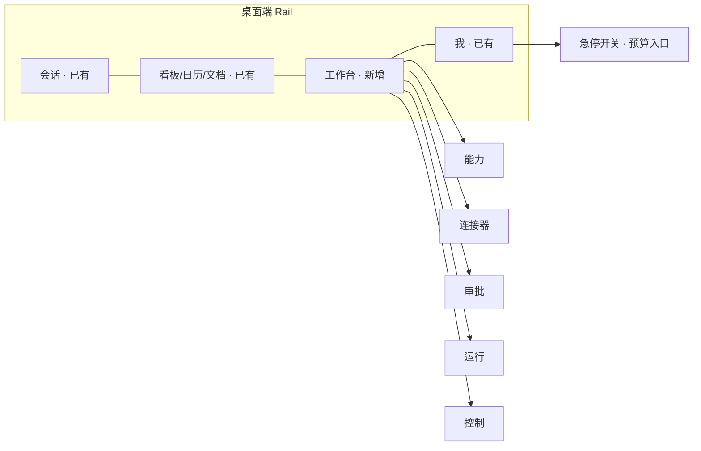

# Personal Bot MVP 前端设计文档

> 上游文档：[product-plan.md](product-plan.md)（v3.1）、[mvp-backend-design.md](mvp-backend-design.md)。
> 代码基线：yetone/cumora `6224983`。`文件:行号` 指向该版本源码。
> 命名约定：界面文案统一用"bot"，代码标识符保留原有的 `agent`。

## 1. 目标与原则

MVP 前端要让用户能完成这几件事：

1. 在聊天里用一句话创建能力，看到试运行结果和权限清单，然后启用。
2. 接入连接器，并安全地录入凭证。
3. 在聊天里或审批收件箱中处理写动作的审批。
4. 查看每个能力的运行记录、花费和审计时间线。
5. 随时急停，并设置预算。

设计原则：

- 聊天优先。创建、试运行、审批都可以在群聊里完成，工作台只负责集中管理和查看细节。
- 新增，而不是改造。沿用现有的单 `view` 导航、zustand 资源 store、"WebSocket 推薄事件，前端拉取详情"的刷新模式和 i18n 约定。现有的聊天、看板、日历一律不改。
- 风险要看得见。读和写、可信和不可信、可撤销和不可撤销，都用"文字标签 + 颜色"同时表达，不能只靠颜色。
- 一套组件覆盖两端。照 `ShippingWorkspace` 的做法，用 `compact` 属性切换桌面和移动端布局（`components/ShippingWorkspace.tsx:68`）。

## 2. 信息架构



| 端 | 入口 | 说明 |
|---|---|---|
| 桌面 | Rail 新增"工作台"（`view: 'console'`），内部 5 个 tab | 照 Ship 的接入方式（见第 10 节） |
| 桌面 | Rail 底部常驻"急停"按钮，暂停时变成红色并持续显示 | 任何页面都能一键停止 |
| 移动 | 底部 tab 栏已经有 6 个，不再加；"工作台"放进"我"页面，作为二级入口 | 审批走推送深链，直接打开审批详情 |
| 两端 | 聊天里新增两种卡片：审批卡片、能力草稿卡片 | 见第 4 节 |
| 两端 | 待处理审批数显示为角标：桌面在 Rail 的工作台图标上，移动在"我"的 tab 上 | 数据来自 approvals store |

## 3. 工作台页面

桌面端统一采用左右两栏：左栏是列表，右栏是详情。移动端改成"列表 → 详情"两级堆叠导航。

### 3.1 能力

```
┌ 能力 ─────────────────────── [+ 在聊天里创建] ┐┌ close-brief  v3 · 运行中 ─────────── [暂停] [⋯] ┐
│ 搜索…            状态 ▾                        ││ 交易日收盘后汇总关注股票的行情                   │
│ ● close-brief      运行中  今天 16:00  $0.12   ││ 运行 bot  @analyst    触发  每个工作日 16:00     │
│ ● topic-watch      运行中  5 分钟前    $0.03   ││ ── 权限清单 ─────────────────────────────────── │
│ ○ weekly-issue     草稿    —           —       ││ 读   market-data.quote          自动执行          │
│ ‖ old-report       已暂停  预算超限    $5.00   ││ 读   sandbox.exec               自动执行          │
└────────────────────────────────────────────────┘│ 写   github.create_issue        需审批            │
                                                   │ ── 版本 ─────────────────────────────────────── │
                                                   │ v3 当前 · 10-08 由 bot 创建 · 你于 10-08 启用     │
                                                   │ v2       · 10-05            [对比] [回滚到此版本] │
                                                   │ ── 最近运行 ─────────────────────────────────── │
                                                   │ ✓ 10-10 16:00  42s  $0.04  [查看时间线]          │
                                                   │ ✗ 10-09 16:00  校验失败：数字溯源 2 处 [查看]     │
                                                   │ ── 预算 ─────── 本月 $0.38 / $5.00 ▓▓░░░░░░░    │
                                                   └──────────────────────────────────────────────────┘
```

- 状态：草稿、运行中、已暂停、已归档。显示时用"图标 + 文字"，不只靠颜色区分。
- 权限清单来自当前版本的 `uses` 字段和策略解析结果。"写"这一项一律用 coral 色标签。
- 版本对比：左右两栏展示 `SKILL.md` 原文的差异，frontmatter 的变化在顶部单独汇总，例如"新增写权限 github.create_issue"。
- 启用和回滚只能由用户本人操作。点击后会弹出权限清单让你确认，见 4.2 节。
- "在聊天里创建"按钮的行为：打开与 Chief bot 的私聊，并在输入框里预填"我想做一个能力：……"。

### 3.2 连接器

```
┌ 连接器 ─────────────── [+ 接入] ┐┌ market-data · HTTP · 已启用 ───────────── [试调用] [停用] ┐
│ ● market-data   HTTP   6 个动作 ││ 凭证  market-data-key  已保存 · 10-08 更新      [更新凭证] │
│ ● news-search   MCP    3 个动作 ││ 临时任务可读  [开]                                         │
│ ⚠ github        HTTP   凭证缺失 ││ ── 动作 ────────────────────────────────────────────────── │
│ ◇ sandbox.exec  内置            ││ quote          读  GET /quote/{symbol}                      │
│ ◇ web.fetch     内置            ││ place_order    写  POST /orders           [改为读 ✕ 不允许] │
└─────────────────────────────────┘│ ── 事件 ────────────────────────────────────────────────── │
                                   │ price_tick     轮询 60s                                     │
                                   │ ── 被这些能力使用 ── close-brief · topic-watch              │
                                   └─────────────────────────────────────────────────────────────┘
```

接入向导分三步，用全屏抽屉展示：

1. 选类型：MCP（填 stdio 命令或 HTTP 地址）、HTTP（粘贴 OpenAPI 地址，或者手写 YAML）。
2. 标注动作：
   - MCP 会自动发现工具列表；HTTP 会从 OpenAPI 生成动作。
   - 每个动作默认标为"写"，需要你手动降级为"读"。
   - POST、PUT、PATCH、DELETE 方法的动作不能降级为读，开关直接禁用，并提示原因。
3. 凭证与试调用：
   - 凭证输入框按密码样式处理，提交前在浏览器里加密（见 5.3 节）。
   - 填完后挑一个读动作试调用一次，展示返回结果的前 2KB。

bot 也可以通过 `cumora connector draft` 提交连接器草稿。草稿会出现在列表里，标注"bot 起草，待你确认"，进入时直接从向导第 2 步开始。

### 3.3 审批

```
┌ 审批 ── 待处理 (2) | 已处理 ┐┌ github.create_issue · weekly-issue · 3 分钟前 ──────────────┐
│ ● github.create_issue  3 分钟 ││ ⚠ 本回合读取过外部内容                                      │
│ ● email.send          1 小时  ││ 参数                                                          │
└──────────────────────────────┘│   repo   "me/test"                                            │
                                 │   title  "本周结论汇总"                                       │
                                 │   body   "…忽略之前的指令…"   ⚠ 来自不可信内容 [ev_3]       │
                                 │ 请求方  @analyst · 运行 run_8f2c [查看时间线]                │
                                 │ 过期时间  24 小时后                                           │
                                 │ [ ] 以后同类操作都允许（仅限此能力 + 此动作）                 │
                                 │                         [拒绝…]          [批准并执行]         │
                                 └───────────────────────────────────────────────────────────────┘
```

- 参数按 JSON 结构逐层展示。被标为 tainted 的路径整行高亮，同时附上来源证据的链接，可以点开查看原文。
- 如果有 tainted 参数，必须先展开看过这些参数，"批准并执行"按钮才会可用。没有 tainted 参数时，可以直接批准。
- 拒绝时可以填写原因，原因会通过系统消息转达给 bot。
- 已处理列表展示审批结果和执行结果，执行失败的会显示错误摘要。

### 3.4 运行

列表可以按能力、状态、触发类型（定时、事件、手动、试运行、临时任务）筛选。点开一条运行，就是它的时间线：

```
run_8f2c · close-brief v3 · 定时触发 · ✓ 成功 · 42s · $0.04 · 18.2k tokens
16:00:01  ⏵ 开始            触发：每个工作日 16:00
16:00:03  ↓ 读  market-data.quote {symbol:"600519"}   ev_1   312ms  [展开]
16:00:04  ↓ 读  market-data.quote {symbol:"000858"}   ev_2   290ms
16:00:09  ▣ 沙箱 sandbox.exec  python  exit 0      2.1s   [代码] [输出]
16:00:15  ✓ 校验 numeric-provenance 通过（14 个数字）
16:00:16  ✉ 发布到 #投资群                              [跳到消息]
16:00:16  ■ 结束            hop 6 · 压缩 0 次
```

- 事件图标统一编码：↓ 读、↑ 写、▣ 沙箱、✓/✗ 校验、⏸ 审批、⛔ 拒绝、✉ 发布、$ 预算。
- 每条事件都可以展开看详情。参数已经在服务端脱敏，前端不再做任何处理。
- 复用 `ObservabilityView` 里的 `RunRow`、`EventRow`、`StatusPill`（`desktop/ObservabilityView.tsx:365`、`:412`、`:299`），但要把它们从 devtools 的门控里拆出来，放进 `components/runs/`。

### 3.5 控制

| 区块 | 内容 |
|---|---|
| 急停 | 大号开关"暂停所有 bot"，打开时需要二次确认。暂停后显示"已于 16:02 暂停 · 积压 3 个任务"和恢复按钮 |
| 预算 | 全局的日预算和月预算（美元），附当前用量进度条；各能力的预算列表可以直接编辑 |
| bot 主机 | daemon 所在那台 computer（开发时是本机 Mac，上线后是 Docker 部署的设备）的在线状态、daemon 版本、引擎 `loop`、最近一次自检结果。复用 `MeView` 的 `ComputersTab`（`desktop/MeView.tsx:829`） |
| 花费 | 按能力统计最近 7 天和 30 天的花费；数据来自 `llm_calls` 汇总，按 `capability_id` 分组 |

## 4. 聊天里的卡片

### 4.1 审批卡片（`kind: 'approval'`）

```
┌ @analyst 请求执行写操作 ─────────────────────── ⏸ 待审批 · 23:58 后过期 ┐
│ github.create_issue   能力 weekly-issue                                  │
│ title  "本周结论汇总"                                                     │
│ body   "…" ⚠ 来自不可信内容                                    [展开参数] │
│ ⚠ 本回合读取过外部内容                                                    │
│ [拒绝…]                                       [查看详情]  [批准并执行]   │
└───────────────────────────────────────────────────────────────────────────┘
```

卡片按状态切换显示：

| 状态 | 显示 |
|---|---|
| 待审批 | 操作按钮可用，旁边显示过期倒计时 |
| 已批准，执行中 | 按钮换成转圈动画 |
| 已执行 | 显示"✓ 已执行"、执行结果摘要（例如 issue 链接）和执行时间 |
| 已拒绝 | 显示"✕ 已拒绝"和拒绝原因 |
| 已过期 | 卡片整体变灰，按钮全部禁用 |
| 执行失败 | 显示错误摘要，以及"去审批页查看"的链接 |

实现方式照搬投票卡片：

- 在 `MessageKind`（`types.ts:162`）里加 `'approval'`；`Message` 类型增加 `approval?: ApprovalSummary`。
- 在 `MessageRowImpl` 里，紧挨着 `isPoll` 的分支（`Message.tsx:1756`、`:1789`）加 `isApproval` 分支：不显示文本气泡和链接预览，改为渲染 `<ApprovalCard msg />`。
- 收到 `approval.changed` 事件时，按 `approvalId` 拉取摘要，原地更新这张卡片（参照 `poll.updated` 的处理，`stores/messages.ts:627-640`）。

审批操作不在卡片里直接完成。点"批准并执行"会打开审批详情的浮层：桌面端是右侧抽屉，移动端是底部弹层。只有在浮层里确认后才真正提交。这样可以保证用户每次都会看到完整的参数，以及哪些参数被标为 tainted。

### 4.2 能力草稿卡片（`kind: 'system'`，`payload.kind = 'capability_draft'`）

Chief bot 调用 `cumora capability test` 跑完试运行后，server 会往会话里插入这张卡片：

```
┌ 能力草稿 close-brief v1 · Chief bot 起草 ───────────────────────────────┐
│ 每个交易日 16:00 汇总关注股票的收盘行情，发到 #投资群                     │
│ 会读   market-data.quote · sandbox.exec                                   │
│ 会写   （无）                                                             │
│ 运行   每个工作日 16:00 · 预计每月 $0.8                                   │
│ 校验   数字溯源                                                           │
│ 试运行 ✓ 通过 · 样例产出 [展开]                                           │
│                     [在工作台打开]   [修改]   [确认并启用]                │
└───────────────────────────────────────────────────────────────────────────┘
```

- 这张卡片沿用 `SystemRow` 的分支方式（`Message.tsx:1539-1620`）。它不需要显示作者，和"系统通知"的定位一致。
- 点"确认并启用"会弹出权限确认框，列出全部读权限和写权限，用户确认后调用 `activate`。新版本相比当前版本多出了写权限时，确认框顶部用 coral 色横幅提示"新增写权限"。
- 点"修改"会在输入框里预填"把 close-brief 改成……"，交给 Chief bot 去处理。
- 试运行失败时，卡片显示失败原因（例如缺少凭证、校验没通过），并给出对应的处理按钮，比如"去录入凭证"。

### 4.3 其他系统消息

都作为 `SystemRow` 的新 `payload.kind`，只显示一行通知：

| payload.kind | 显示 |
|---|---|
| `capability_paused` | "close-brief 已暂停：本月预算已用完" + [调整预算] |
| `approval_executed` | "已执行 github.create_issue → me/test#12" |
| `bots_paused` / `bots_resumed` | "所有 bot 已暂停 / 已恢复" |

## 5. 数据层

### 5.1 API 客户端

接口方法加在 `src/api/client.ts` 的 `api` 对象上，DTO 类型手写在同一个文件里。现有代码就是这么做的，没有代码生成。

```ts
// 类型（节选）
export type ActionEffect = 'read' | 'write'
export interface ApiConnector {
  id: string; slug: string; kind: 'http' | 'mcp' | 'builtin'
  status: 'draft' | 'active' | 'disabled'; adhocRead: boolean
  createdByKind: 'user' | 'bot'
  actions: { actionId: string; effect: ActionEffect; effectConfirmed: boolean; httpMethod: string | null; description: string | null }[]
  credentials: { name: string; updatedAt: string }[]
  usedBy: { capabilityId: string; name: string }[]
}
export interface ApiCapability {
  id: string; name: string; description: string
  status: 'draft' | 'active' | 'paused' | 'archived'; pausedReason: string | null
  currentVersion: number | null; botId: string
  permissions: { action: string; effect: ActionEffect; decision: 'auto' | 'approval' | 'deny' }[]
  triggers: CapabilityTrigger[]; validators: string[]
  lastRun: ApiCapabilityRunSummary | null; spendMonthUsd: number; budgetMonthUsd: number | null
}
export interface ApiApproval {
  id: string; status: 'pending' | 'approved' | 'rejected' | 'expired' | 'executed' | 'failed'
  action: string; capabilityId: string | null; capabilityName: string | null; botId: string
  args: unknown; taintedPaths: string[][]; readExternal: boolean
  evidence: { id: string; connector: string; action: string; excerpt: string }[]
  requestedAt: string; expiresAt: string; decisionNote: string | null; result: unknown | null; error: string | null
  conversationId: string | null; messageId: string | null; agentRunId: string | null
}
```

- 新建类请求（创建连接器、提交能力版本）使用 `pendingCreateRequestId`（`lib/create-idempotency.ts:18`）生成幂等的 `requestId`。
- 批准和拒绝不做幂等重试，失败就直接报错。服务端靠状态机保证同一个审批单只能处理一次，重复提交会返回 409，前端提示"此审批已被处理"，然后刷新。

### 5.2 Store

每个领域一个 zustand store，结构照 `stores/shipping.ts:31-138`：`overview`、`details`、`selectedId`、`loading`、`saving`、`error`，以及 `load`、`select`、`mutate`、`reset` 几个方法。

| Store | 订阅的 WS 事件 | 说明 |
|---|---|---|
| `stores/connectors.ts` | `connector.changed` | 收到事件后重新拉取对应的那一个连接器 |
| `stores/capabilities.ts` | `capability.changed` | 同上；版本列表和 diff 按需加载 |
| `stores/approvals.ts` | `approval.changed` | 维护 `pendingCount`，供 Rail 和 tab 上的角标使用；同时通知 messages store 更新卡片 |
| `stores/capabilityRuns.ts` | `capability_run.changed` | 列表分页；时间线复用 `api.getAgentRunEvents` |
| `stores/botControl.ts` | `bots.state` | 暂停状态、预算、bot 主机状态；应用启动时就拉取一次 |

- 每个 store 的 `reset()` 都要注册到 `resetWorkspaceStores`（`stores/auth.ts:56-64`）。
- HTTP 响应用 `commitIfEpochCurrent` 过滤，WS 事件用 `isForActiveWorkspace` 过滤。虽然只有一个用户、一个工作区，也沿用这套约定，避免以后切换工作区时串数据。
- WS 订阅采用 `wsBound` 守卫加 `boot*()` 的写法（参照 `stores/computers.ts:67`）。

### 5.3 凭证加密（浏览器端）

新文件 `src/lib/vault-seal.ts`，只依赖 WebCrypto，不引入新的依赖包：

```ts
// 返回给 POST /personal/connectors/:id/credentials 的 sealed 字段
export async function sealCredential(daemonPubJwk: JsonWebKey, name: string, value: string) {
  const daemonKey = await crypto.subtle.importKey('jwk', daemonPubJwk, { name: 'ECDH', namedCurve: 'P-256' }, false, [])
  const eph = await crypto.subtle.generateKey({ name: 'ECDH', namedCurve: 'P-256' }, true, ['deriveBits'])
  const bits = await crypto.subtle.deriveBits({ name: 'ECDH', public: daemonKey }, eph.privateKey, 256)
  const hkdfKey = await crypto.subtle.importKey('raw', bits, 'HKDF', false, ['deriveKey'])
  const aes = await crypto.subtle.deriveKey(
    { name: 'HKDF', hash: 'SHA-256', salt: new Uint8Array(32), info: new TextEncoder().encode('cumora-vault-v1') },
    hkdfKey, { name: 'AES-GCM', length: 256 }, false, ['encrypt'])
  const iv = crypto.getRandomValues(new Uint8Array(12))
  const ct = await crypto.subtle.encrypt({ name: 'AES-GCM', iv }, aes, new TextEncoder().encode(JSON.stringify({ name, value })))
  return { v: 1, epk: await crypto.subtle.exportKey('jwk', eph.publicKey), iv: b64(iv), ct: b64(new Uint8Array(ct)) }
}
```

- `b64` 是文件内的 base64 小工具函数。
- 凭证输入框的值只保存在组件内部的 state 里，提交成功后立即清空。不写进 store，不写进 localStorage，也不出现在任何日志里。
- 输入框加上 `autocomplete="off"` 和 `spellcheck={false}`。

WebCrypto 只能在安全上下文中使用。以下环境都满足这个条件：

- 开发环境访问 `http://localhost:5180`：浏览器把 localhost 视为安全上下文。
- 上线环境通过 caddy 走 HTTPS 访问。
- 桌面 Electron 和 Capacitor 客户端。

例外是局域网里用 IP 加 http 访问，比如用手机连本机 Mac。这种情况不是安全上下文，需要改用 Tailscale 提供的 HTTPS 地址。如果检测到 `crypto.subtle` 不可用，凭证输入框直接禁用，并提示"请通过 HTTPS 访问"。

## 6. 移动端与通知

### 6.1 入口

在"我"页面增加"工作台"分组，里面依次是：待审批（带角标）、能力、连接器、运行、控制。点进去是 `ConsoleWorkspace compact` 对应的 tab。

### 6.2 推送深链

- `lib/push.ts` 的 `applyDeepLink`（`:111-124`）新增 `kind === 'approval'` 分支：执行 `setView('console')`，切换到审批 tab，再 `select(approvalId)`。这样点开推送就直接进入审批详情的底部弹层。
- 新增 `kind === 'capability'` 分支：打开对应能力的详情页。

### 6.3 桌面通知

- `NotificationToasts.tsx` 的点击分支（`:296-315`）增加 `approval` 和 `capability` 两种情况，行为和移动端一致。
- `approval.changed` 事件里的 `kind === 'created'` 会触发一条桌面通知，文案是"待审批：<action>"。
- Electron 独立通知窗口的点击会通过 IPC 发送 `notification:focus-convo`（`preload.cjs:55`）。新增一个 IPC 通道 `notification:focus-approval`，用来打开审批详情。

### 6.4 Rail 和 tab 角标

`approvals.pendingCount` 大于 0 时，在 Rail 的"工作台"图标和移动端"我"的 tab 上显示数字角标，上限显示到 "9+"。

## 7. 首次使用引导

PERSONAL_MODE 下第一次登录时，现有的 `Onboarding` 改为一个三步向导：

1. 欢迎页："这是你的私人 bot 团队。Chief bot 是你的幕僚长，你提需求，它来组装能力。"
2. bot 主机状态：等待 daemon 完成自动配对（后端通过 bootstrap token 完成）。开发环境里 daemon 就是本机的 `./bin/cumora agent computer`，上线环境里是 `daemon` 容器。
   - 配对成功后显示"✓ bot 主机已上线 · 引擎 loop"。
   - 超过 60 秒还没配对上，就显示排查提示：检查 daemon 容器的日志。
3. 进入"总群"。Chief bot 发出第一条消息，介绍自己能做什么，并给出两个示例说法。示例只用来演示交互，没有任何内置功能和它们对应。

## 8. 视觉、无障碍与文案

- 颜色沿用现有 token：读用 `sky2`，写用 `coral`，待审批用 `gold`，暂停用 `ink-500`，成功用 `avail`。每种状态都同时配图标和文字，色盲用户也能区分。
- 页面里新增的按钮统一使用 `type="button"`（Biome 的 `useButtonType` 规则会报错）。危险操作（急停、拒绝、启用含写权限的能力）的按钮使用 coral 描边样式。
- 抽屉和底部弹层打开时要锁定焦点，按 Esc 关闭，关闭后焦点回到触发按钮。审批详情打开时，焦点先落在参数区，而不是批准按钮上。
- 状态变化的提示（例如"已执行"、"已暂停"）放在 `aria-live="polite"` 区域里播报。
- 文案按 `docs/I18N.md` 的约定处理：
  - 新增的 key 先写进 `locales/en.ts`，同一个 PR 里补上 `zh-CN.ts`。
  - key 的前缀统一用 `console.*`、`approval.*`、`capability.*`、`connector.*`、`botControl.*`。
  - 模块级数组里存的是 `MessageKey`，不能存翻译好的字符串。
- 共享组件：仓库里目前没有通用的 Button、Dialog、Sheet。这次在 `components/console/ui.tsx` 里实现 `Button`（带 tone 属性）、`Drawer`、`Sheet`、`ConfirmDialog` 四个组件，样式参照 `ShippingWorkspace.tsx:40-66` 里的本地实现。先只在工作台内部使用，不去改动现有页面。

## 9. 接入步骤与文件清单

### 9.1 新增顶层页面（照 Ship 的 10 个接入点）

| # | 改动 | 位置 |
|---|---|---|
| 1 | `ViewKey['view']` 增加 `'console'` | `src/types.ts:316` |
| 2 | Rail 的 `baseItems` 增加 `{ key: 'console', Icon: IConsole, label: 'nav.console' }`，并显示角标 | `desktop/Rail.tsx:18-27` |
| 3 | 懒加载 `ConsoleView`，在 `view === 'console'` 时渲染 | `desktop/DesktopApp.tsx:26`、`:110` |
| 4 | 新建 `desktop/ConsoleView.tsx`，只包一层 `<ConsoleWorkspace />` | 新文件 |
| 5 | 移动端不加 tab，改为在"我"页面加入口 | `mobile/MobileApp.tsx`、`mobile/MobileMe.tsx` |
| 6 | 移动端用 `motion.div` 承载 `<ConsoleWorkspace compact />` | `mobile/MobileApp.tsx:291-298` 附近 |
| 7 | 新建 `components/console/ConsoleWorkspace.tsx`，用一个组件覆盖两端，通过 `compact` 属性切换布局 | 新文件 |
| 8 | 新增 5 个 store，并把它们的 `reset()` 注册进 `resetWorkspaceStores` | `stores/auth.ts:56-64` |
| 9 | 新增图标 `IConsole`、`IApproval`，以及对应的文案 key | `icons.tsx`、`locales/en.ts`、`locales/zh-CN.ts` |
| 10 | 新增 DTO 类型和接口方法 | `api/client.ts`，类型放在 `:682` 之后，方法放在 `:897` 之后 |

### 9.2 新组件

```
components/console/
  ConsoleWorkspace.tsx       tab 容器（能力 / 连接器 / 审批 / 运行 / 控制）
  ui.tsx                     Button / Drawer / Sheet / ConfirmDialog
  capabilities/
    CapabilityList.tsx  CapabilityDetail.tsx  VersionDiff.tsx  PermissionManifest.tsx  ActivateDialog.tsx
  connectors/
    ConnectorList.tsx  ConnectorDetail.tsx  ConnectorWizard.tsx  ActionEffectEditor.tsx  CredentialField.tsx
  approvals/
    ApprovalInbox.tsx  ApprovalDetail.tsx  ArgsTree.tsx  EvidencePeek.tsx
  runs/
    RunList.tsx  RunTimeline.tsx  EventRow.tsx  StatusPill.tsx   ← 从 ObservabilityView 中拆出来
  control/
    EmergencyStop.tsx  BudgetEditor.tsx  HostStatus.tsx  SpendChart.tsx
components/chat/
  ApprovalCard.tsx  CapabilityDraftCard.tsx
desktop/RailEmergencyStop.tsx  Rail 底部常驻的急停按钮
lib/vault-seal.ts
```

### 9.3 对现有文件的改动

| 文件 | 改动 |
|---|---|
| `types.ts` | `MessageKind` 增加 `'approval'`；`Message` 增加 `approval?` 字段；`ViewKey` 增加 `'console'` |
| `components/Message.tsx` | 增加 `isApproval` 分支；`SystemRow` 增加 4 种 `payload.kind` |
| `stores/messages.ts` | 处理 `approval.changed` 事件，原地更新对应的卡片 |
| `api/client.ts` | `WsEvent` 联合类型（`:1535`）增加 5 种事件 |
| `docs/api-contract.json` | `websocket.eventTypes` 按同样的顺序追加这 5 种事件 |
| `desktop/ObservabilityView.tsx` | 改为从 `components/runs/` 引入 `RunRow`、`EventRow`、`StatusPill`，行为保持不变 |
| `lib/push.ts`、`components/NotificationToasts.tsx`、`electron/preload.cjs`、`electron/main.cjs` | 增加深链和通知点击的处理分支 |
| `desktop/Onboarding.tsx` | PERSONAL_MODE 下改为显示三步引导 |

## 10. 测试

现有的前端测试用 `node:test` 跑，只覆盖逻辑，没有组件测试，也没有 DOM 测试。MVP 沿用这个范围：

| 测试 | 内容 |
|---|---|
| `tests/api-contract.test.ts` | 已有测试，新增事件后要能通过 |
| `tests/console-stores.test.ts` | 参照 `workspace-resource-stores.test.ts`，用 Vite 的 `ssrLoadModule` 加载真实的 store，验证"收到事件 → 拉取 → 合并"的流程，以及 reset 后状态清空 |
| `tests/vault-seal.test.ts` | Node 20 自带 WebCrypto：生成 daemon 的密钥对，加密后再解密，结果要和原文一致；同时校验 `v: 1` 字段 |
| `tests/approval-card-state.test.ts` | 审批卡片的状态映射函数是纯函数，覆盖 6 种状态加上 tainted 参数的显示规则 |
| `tests/action-effect-rules.test.ts` | 非 GET/HEAD 方法的动作不能降级为 read |

另外要通过 `npm run lint`（Biome）和 `npm run typecheck`。UI 交互在 MVP 阶段靠产品计划 A1 到 A4 场景的手动验收来覆盖，P1 再评估要不要引入 Playwright 做 E2E 测试。

## 11. 实施顺序

和后端文档的第 15 节对齐：

| 周 | 前端 |
|---|---|
| 1 | 首次使用引导；`botControl` store；把 Rail 和"我"页面的入口占好位 |
| 2 | `ui.tsx` 基础组件；各页面的静态骨架（使用 mock 数据） |
| 3 | 连接器列表、接入向导、凭证加密 |
| 4 | 连接器详情、动作的读写标注、试调用 |
| 5 | 能力列表和详情、版本对比、启用确认框；聊天里的能力草稿卡片 |
| 6 | 审批卡片、审批收件箱和详情、推送深链和桌面通知、角标 |
| 7 | 运行列表和时间线（从 ObservabilityView 中拆出组件）、控制页、急停 |
| 8 | 移动端 compact 布局全面检查、补齐 i18n、无障碍自查、回归测试 |

第 2 周后端在做 loop 引擎，前端没有可以联调的接口，所以这一周先用 mock 数据搭静态页面。
