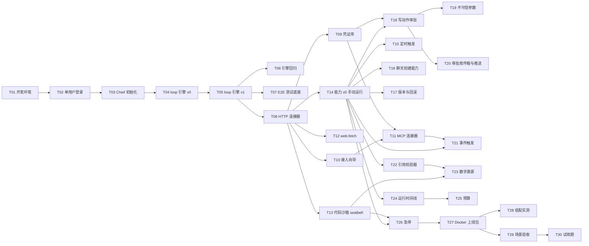

# Personal Bot MVP 开发任务拆解

> 依据：[product-plan.md](product-plan.md) 第 8 节、[mvp-backend-design.md](mvp-backend-design.md)、[mvp-frontend-design.md](mvp-frontend-design.md)。
> 状态：实施中。进度标记和执行约定见文末。

## 拆分原则

- 每个任务都是一个纵向切片：从数据库到 server、daemon、前端，再到测试，一次做完，做完就能单独演示或验证。不按"先做完全部数据库，再做全部接口"的横向方式拆。
- 迁移文件跟着任务走：哪个任务用到哪张表，就在那个任务里新增迁移。所以设计文档里集中的 0011/0012 两个迁移会拆成多个小迁移，编号在实施时按顺序分配。表结构仍以后端文档第 4 节为准。
- 类型：AFK 表示可以独立做完并合并；HITL 表示需要人参与，比如提供密钥、跑真实模型、在真机上验收、做决策。
- 规模：S 约 1–2 人日，M 约 3–5 人日，L 约 6–8 人日。都是粗估，没有细排。
- 每个任务都默认包含：中英文文案（`en.ts` 和 `zh-CN.ts`）、单元测试，并通过 `lint`、`typecheck`、`npm test` 和相关的守卫检查。

## 依赖关系

## 阶段一：地基（第 1–2 周）

### T01 本机开发环境与 PERSONAL_MODE · HITL · S ⏸

做什么：在 Mac 上按后端文档 2.1 节把原版 Cumora 跑起来，然后加上 `PERSONAL_MODE` 开关。开关打开后，不再插入演示数据，不再执行 starter 团队的初始化，scheduler 也不再调用 `ensurePod`。

验收：
- [x] `deploy/personal/dev.env.example` 已加入仓库（复制为根目录 `.env`）。
- [ ] 照着它执行 `npm run dev:all`，server 和 Vite 都能正常启动。⏸ 本机缺 Redis，待你决定 Redis 的提供方式后补验。
- [x] 开关打开时，演示数据、占位用户、starter 团队和它的启动回填都会跳过（`personal-mode.test.ts` 验证这些路径不发出任何查询）；scheduler 不再调用 `ensurePod`。用真实空库启动的验证已由 T07 的 e2e 冒烟用例覆盖：每次清空 schema，迁移后在个人模式下启动，只会出现 Chief 和总群（CI 运行 38129482127）。
- [x] 开关关闭时，行为和上游完全一致：改动只是在开关打开时提前返回。
- [x] 补充开发环境 README：[deploy/personal/README.md](../../deploy/personal/README.md)。uv 沙箱虚拟环境属于 T13，届时再补进去。

依赖：无。需要人做的部分：安装 Homebrew、Postgres、Redis，提供 `OPENAI_API_KEY`。

### T02 单用户本机登录 · AFK · S ⏸

做什么：设置 `PERSONAL_LOCAL_LOGIN=1`，并且 server 只监听 127.0.0.1 时，启动后在终端打印一次性登录链接，打开就能进入前端。另外，在 PERSONAL_MODE 下，第二个用户无论走哪种方式都无法注册，也不能新建工作区。

验收：
- [x] 登录链接 10 分钟后失效，用过一次就失效（`personal-local-login.test.ts`）。
- [x] 前端能读取 `#login=` 参数，完成登录：`AuthGate` 在模块加载时读取并清掉片段，换取会话；StrictMode 下也只消费一次。⏸ 需要真实环境在浏览器里走一遍，和 T01 的启动验证一起补。
- [x] 同时设置 `NODE_ENV=production` 和本机登录，或者监听地址不是回环地址时，server 拒绝启动。`LISTEN_HOST` 必须是字面量回环地址，`localhost` 也会被拒绝。
- [x] 第二个用户被拒绝：OAuth 新用户、等候名单审批、本机登录三条创建用户的路径都先经过同一个占位检查（`personal/owner.ts`，带事务级 advisory lock）；新建工作区的接口返回 403。
- [x] 以上各项都有单元测试。新建工作区的 403 是接口开头的一行判断，没有单独写路由测试。

依赖：T01。

### T03 个人模式初始化：Chief bot、总群和自动配对 · AFK · M ⏸

做什么：首次登录后自动执行 `onboardPersonal`，创建 Chief bot、"总群"、你和 Chief 的私聊。daemon 在没有 `computer.json` 时，用 bootstrap token 自动配对，然后把 Chief 分配给自己。这个阶段 Chief 暂时用现有的 `claude` 引擎，先保证整条链路能跑通。前端做三步引导页。

验收：
- [x] 空库首次登录后，能看到总群和 Chief：Chief、置顶的总群（成员是你和 Chief）、私聊都会创建（集成测试 `personal-onboarding.test.ts`，跑在真实的 Postgres 上）。"在总群里 @Chief 会收到回复"已由 T07 的 e2e 冒烟用例在 CI 里验证：真实的 server 和 daemon，自举配对，模型用回放。
- [x] bootstrap 接口校验 token 时用常量时间比较；配对成功后接口返回 410；PERSONAL_MODE 关闭时这个接口不存在。另外：没有主人时返回 409，daemon 收到后等待重试；密钥少于 32 个字符时 server 拒绝启动。
- [x] 重启 server 不会重复初始化：`personal_seeded_at` 生效，并发的首次登录也只生成一个 Chief；启动回填会把中途中断的初始化补完。
- [x] 引导页在 60 秒内没配对成功时，显示排查提示：个人模式下显示等待主机的页面，不显示配对码。⏸ 需要在浏览器里看一遍。
- 偏差：引导页只做了两段（说明加主机状态），没做成三步。配对成功后，现有的 gate 会自动切到主界面，第三步"进入总群"就是这一跳。Chief 的第一条欢迎消息没有做，T16 给 Chief 预置技能时一起加。

依赖：T02。

### T04 loop 引擎 v0：能在群里对话 · AFK · M ⏸

做什么：新增 `loop` 引擎并在所有注册表中登记，接上 OpenAI Responses 的流式调用。工具只开放 `cumora`、`read_file`、`write_file`、`edit_file`、`set_turn_status` 这几个。Chief 的默认引擎改成 `loop`。

验收：
- [x] `guard:engine-registry` 通过，`EngineId` 的 3 处定义、`LlmCallSource`、`TriageSource` 都已更新。另外新增 `IN_PROCESS_ENGINE_IDS` 类别：`loop` 没有二进制，所以不走 PATH 检测、版本门槛和 doctor 的 PATH 查找；daemon 有 `OPENAI_API_KEY` 时才算可运行，否则在 Computers 页显示原因。
- [x] Chief 用 `loop`：初始化时 engine 设为 `loop`，配对时保留。会话单元测试用脚本化的流驱动，验证了调用 Cumora 工具（argv 原样转发，HELD 的 exit 2 交回给模型）、只有终态才结束回合、插话在 hop 边界送达、hop 上限。在总群里 @Chief，经由 loop 引擎和 `mcp__cumora__cli` 收到回复：T07 的 e2e 冒烟用例在 CI 里用回放模型验证通过。⏸ 换成真实模型的回复，等 T06 有 key 时再验。
- [x] 文件工具不能访问 home 以外的路径，也不能通过符号链接逃出 home：对最近一层已存在的祖先目录做 realpath 再检查，读和写都覆盖了，`loop-tools.test.ts` 有对应测试。
- [x] `--doctor` 能探测主力模型和辅助模型两档：`probe` 按档位各发一次最小请求；`probeWake` 标为 skipped，因为唤醒路径就是同一个进程内调用。⏸ 真实探测需要 key。
- [x] 每个 hop 都通过 `onHopUsage` 写进 `llm_calls`（来源记为 `byoa-loop`）。OpenAI 的 usage 换算成 ledger 的字段：未命中缓存的 input 加 cache read。`guard:llm-tracked` 和 `guard:big-brain` 都通过。
- 实现说明：直接用 `fetch` 调 Responses API，自己写了一个小的 SSE 解析器，没有引入 `openai` SDK（只用到它的类型）。这样 agent-cli 的单文件包仍然是 409KB。`LoopAdapter` 写在 `engine.ts` 里，因为放在单独文件会和 `ADAPTERS` 形成运行时的循环依赖。8KB 输出截断提前在这里做了（原计划在 T05）。

依赖：T03。

### T05 loop 引擎 v1：移植生产机制 · AFK · L ✅

做什么：把后端文档 5.3 节的机制全部移植过来，包括摘要压缩、状态协议提醒、完成复核、插话中止工具批次、8KB 截断、两类重试、错误映射到 `EngineFailure`；再加上 history.jsonl 的持久化和恢复。

验收：
- [x] 用 mock provider 写单元测试（`loop-session-v1.test.ts`，15 个），覆盖：压缩被触发（摘要走辅助模型；摘要失败时丢弃旧回合；压缩后仍放不下时返回 context-overflow）、连续两次没声明状态后判为协议违规、插话中止正在执行的工具（以及非中止的插话会等工具跑完）、连接失败重试两次、429 不重试并让 daemon 的 `classifyTurnOutcome` 判为 rate-limited 进入冷却、恢复失败时开新会话（文件不存在、中间行损坏、属于别的会话三种情况）。另外覆盖完成复核的拒绝、跳过、出错和次数上限。
- [x] 重启 daemon 后，会话从 history.jsonl 恢复，上下文不丢：测试中用同一个 historyDir 和 sessionId 新建一个会话，下一次请求里带着上一个会话的内容；同时覆盖了最后一行被截断、未配对调用的修复，以及压缩后原子重写文件。⏸ 真正重启 daemon 进程的验证要等 Redis 和真实 key，放到 T06/T07。
- [x] `guard:big-brain` 通过：压缩和复核用的是辅助模型（`fastModel`，默认 `gpt-5.4-mini`），记账用途分别是 `compaction` 和 `completion-verify`，测试中有断言。
- 实现说明：daemon 现在把 `/runtime/cli` 返回的 `sideEffects` 透传给引擎，复核据此判断"是否已经 reply"，不靠猜命令文本。`contextWindowFor` 等三个预算函数挪进了 turn-compaction.ts，turn.ts 改为 import。agent-cli 包从 409KB 增加到 430KB，里面没有混进 pg、ioredis 或 openai SDK。

依赖：T04。

### T06 引擎回归：chain 和 counting · HITL · S ⏸

> 暂缓（2026-10-11，用户决定）：本机没有真实的 OpenAI key，先做 T07 和 T08，有 key 之后再补跑。

做什么：让 `benchmarks/` 能指定 `loop` 引擎运行，用真实模型跑 chain 和 counting 两个协作场景，和 COORDINATION.md 里的基线对比。

验收：
- [ ] chain 8/8 按顺序完成，没有重复；counting 没有碰撞。
- [ ] 达不到基线时，在文档里写清楚差距和原因，由人决定是继续修还是接受。

依赖：T05。需要人做的部分：提供真实的 OpenAI key，并评审结果。

### T07 端到端测试底座 · AFK · M ✅

做什么：搭一套 daemon 端到端测试框架，包括录制回放的 fake OpenAI、fake HTTP 连接器、fake MCP 服务器，用脚本一键启动 server 加 daemon。同时在 PR CI 里新增一个 job。后面各个任务的 B 类测试都挂在这套框架上。

验收：
- [x] 一条冒烟用例：总群里 @Chief，收到预先录好的回复（`server/src/__e2e__/smoke.e2e.ts`）。CI 运行 38129482127 里真正执行并通过，用时 4.5 秒，没有跳过。本机没有 Redis 时用例会跳过。
- [x] CI job 在 Linux 上通过，总耗时 10 分钟以内：`Daemon e2e` job 共 61 秒（`timeout-minutes: 10`）。同一次运行里，单元测试有 Redis 时 1612 个 0 失败，集成测试 443 个 0 失败。
- 实现说明：
  - fake OpenAI 支持录制和回放。回放时按请求类型匹配：带工具的是 agent hop，不带工具的是 one-shot 调用。还可以按输入正则匹配，正则里的命名分组用 `{{name}}` 代入回复，这样录好的回复能跟着本次运行的会话 id 走。没有匹配上的 agent 请求直接返回 500 并记录下来，用例会失败，而不是等 bot 沉默直到超时。录制模式会把请求转发给真实 API，并把本次运行特有的值替换成占位符。
  - fake HTTP 是一个按路由返回固定内容的服务，会记录所有请求，留给 T08 用。
  - fake MCP 服务器推迟到 T11：MCP 的传输方式要等那时才定，现在写会是猜测。
  - `pr.yml` 增加了 push 到 `personal-bot` 和 `workflow_dispatch` 两种触发，这样 fork 上不开 PR 也能跑全部检查。
  - 数据库名必须以 `_e2e` 结尾，因为每次启动都会删掉它的 public schema。

依赖：T05。

## 阶段二：连接器（第 3–4 周）

### T08 HTTP 连接器，做通最小链路 · AFK · L

做什么：用户粘贴一份 YAML，接入一个不需要鉴权的 HTTP 连接器，并开启"临时任务可读"。之后在总群里让 Chief 调用这个连接器的读动作，能拿到带证据编号的结果。

这个任务要打通的链路：

- 数据库：建 `connectors` 和 `connector_actions` 两张表。
- REST：连接器的新建、列表、详情三个接口。
- Broker：注册表、`/runtime/broker/scope` 和 `/runtime/broker/authorize`（只实现读动作和越权拒绝这两条分支）、HTTP 执行器（只允许 https，拦截私网地址，超时、大小和限流都要做）、证据库、不可信标记、run 事件 `connector.call` 和 `connector.denied`。
- loop 工具：`connector_list`、`connector_describe`、`connector_call`。
- 前端：工作台外壳（只有连接器 tab，列表加只读详情）、Rail 入口、移动端"我"页面的入口，以及 `components/console/ui.tsx` 里的基础组件。

验收：
- [ ] 产品计划 A4 的最小版本：在总群里提问，Chief 调用读动作后作答，审计里能看到这次调用（`server/src/__e2e__/connector.e2e.ts`：Chief 读到 fixture 服务的报价，结果编号为 `ev_1`，回复里引用了 `[ev_1]`，`agent_events` 里有对应的 `connector.call`）。⏸ 本机没有 Redis，这条在 CI 里验证。
- [ ] B2：调用不在授权范围内的动作，会被拒绝并写进审计。同一个 e2e 用例里，Chief 先尝试调用写动作，被拒绝后由服务端写入 `connector.denied`；fixture 服务没有收到这次请求。集成测试 `personal-connectors.test.ts` 覆盖了 authorize 的全部拒绝分支（草稿、写动作、未知动作、未知连接器、名字不合法、跨工作区、没开临时任务可读），本地在 Postgres 上通过。⏸ e2e 部分在 CI 里验证。
- [x] 请求私网地址、http 明文地址、响应超过 2MB，都会被拒绝，有对应测试（`broker.test.ts`）：私网 IP 字面量和本地主机名在建立连接前就会拒绝；公网域名解析到私网地址的情况，在 socket 自己的 lookup 里拦截，所以检查的地址就是实际连接的地址（防 DNS rebinding）；超过 2MB 的响应会被中途切断；超时和限流也都有测试。重定向不跟随。
- [x] 新增的 WS 事件 `connector.changed` 同步改了 4 处：`ws.ts` 的订阅列表、`client.ts` 的 `WsEvent`、`api-contract.json`、事件带 `companyId`。`api-contract` 测试通过。
- 实现说明：
  - 定义和地址规则放在 `server/src/broker/definition.ts`，不依赖任何第三方包，daemon 和 server 共用。YAML 解析（js-yaml）只在 server 侧做，daemon 拿到的是解析好的 JSON，所以 agent-cli 包里没有 js-yaml，现在是 450KB。
  - 服务端是策略的唯一来源：daemon 每次调用前都要 authorize，执行时用的是服务端这次返回的定义，不用缓存。拒绝在服务端写审计，即使 daemon 没上报也有记录。
  - 只有进程内引擎（loop）会拿到 Broker。daemon 第一次开会话前探测一次 `/runtime/broker/scope`，非个人模式的 server 返回 404，这时不会提供连接器工具。
  - 这次没做、留到后续任务的：凭证（T09）、逐个动作确认读写标注和修改动作（T10）、引导式接入向导（T10）。连接器调用目前不受 interrupt 插话中止，只受 30 秒超时约束。
  - e2e 里的 fixture 服务跑在 `http://127.0.0.1`，所以加了两个仅供测试的开关：server 的 `PERSONAL_CONNECTOR_ALLOW_LOOPBACK_HTTP` 和 daemon 的 `CUMORA_BROKER_ALLOW_LOOPBACK_HTTP`。它们只放行 http 访问回环地址，其他私网地址仍然拦截；server 在生产环境下设置这个开关会拒绝启动。

依赖：T05。

### T09 凭证库与端到端加密录入 · AFK · L

做什么：凭证库放在 daemon 侧，开发环境的主密钥存在 macOS 钥匙串里。daemon 上报 ECDH 公钥；新增设备级事件流 `GET /api/computers/me/events`，传递 `vault.put`。前端在浏览器里加密凭证。HTTP 执行器调用时注入凭证，并对输出做脱敏。另外提供命令行入口 `cumora agent computer vault set`。

验收：
- [ ] 能接入一个需要 API key 的 HTTP 连接器，调用成功。
- [ ] 凭证明文不出现在 server 的数据库、server 日志和 server 收到的请求体里。
- [ ] B5：用凭证值去扫描日志、run 事件和模型上下文快照，没有命中。
- [ ] daemon 离线时，保存凭证会返回 409，前端显示提示。
- [ ] 补上 `vault-seal` 加解密往返的单元测试。

依赖：T08。

### T10 连接器接入向导与读写标注 · AFK · M

做什么：做前端的三步向导：选择类型 → 标注动作 → 录入凭证并试调用。动作默认标为写，非 GET/HEAD 的动作不能改成读。实现 `POST /personal/connectors/:id/test`。提供 bot 命令 `cumora connector draft`，bot 起草的连接器会显示"待你确认"。

验收：
- [ ] 用 OpenAPI 地址导入后能自动生成动作列表；手写 YAML 也能导入。
- [ ] 把 POST 动作改成读，服务端返回 400，前端的开关是禁用状态。
- [ ] 试调用能展示返回结果的前 2KB。
- [ ] bot 起草的连接器，需要用户确认后才会启用。

依赖：T08。凭证那一步依赖 T09，可以先用无需鉴权的连接器把流程跑通。

### T11 MCP 连接器 · AFK · M

做什么：Broker 作为 MCP 宿主，支持 stdio 和 Streamable HTTP 两种接入方式。通过设备事件触发工具发现，发现到的工具映射成动作，再走标注流程。MCP SDK 锁定到精确版本。

验收：
- [ ] 接入一个 fake MCP（T07 底座里的）和一个真实的公开 MCP，都能完成发现和调用。
- [ ] stdio 子进程只能拿到属于它自己的那一份凭证。
- [ ] MCP 返回的内容同样被打上不可信标记，并写进证据库。

依赖：T09、T10。

### T12 内置连接器 web.fetch · AFK · S

做什么：内置一个只读连接器，抓取网页并抽取正文。出网规则和 HTTP 执行器一致。

验收：
- [ ] 能抓到公开网页的正文；私网地址和超大页面会被拒绝。
- [ ] 返回结果带上不可信标记和证据编号。

依赖：T08。

### T13 代码沙箱（seatbelt 实现） · AFK · M

做什么：定义统一接口 `SandboxRunner`；实现 macOS 上的 `seatbelt`，包括 profile 和 uv 虚拟环境；内置连接器 `sandbox.exec`。输入通过 `in/ev_n.json` 传入，输出从 `out/` 取出作为产出物。超时后按进程组 kill。

验收：
- [ ] B4：在沙箱里联网、读取 `/etc` 以外的系统敏感路径、读取 home 目录、读取凭证库，全部失败。这条测试只在 macOS 上运行。
- [ ] 能用 pandas 处理传入的证据，并输出一张图。
- [ ] 运行超过 120 秒会被终止，不留下残留进程。

依赖：T08。

## 阶段三：能力（第 5 周）

### T14 能力 v0：手写定义，手动运行 · AFK · L

做什么：做出能力的最小闭环，具体包括：

- 解析：实现 `parseCapabilityMd`，基于 js-yaml，兼容旧版的 `parseSkillMd`。
- 数据库：建 `capabilities`、`capability_versions`、`capability_runs` 三张表。
- REST：提交版本、启用（只接受用户会话）、手动运行。
- 启用：启用时把 `SKILL.md` 写入运行它的 bot 的 `agent_workspace`。
- runtime 接口：领取和完成运行，领取时用 `SKIP LOCKED` 加锁。
- daemon：新增 `maybeCapabilityTurn`，这条路径不经过 triage；授权范围就是能力里声明的 `uses`。
- 前端：工作台的能力 tab，包括列表、详情、权限清单，以及一个"立即运行"按钮。

验收：
- [ ] 手写一个只读能力（用 T08 的连接器），启用后点"立即运行"，结果会发到指定的会话里。
- [ ] 用 runtime JWT 调用启用接口，返回 403。
- [ ] 能力调用了 `uses` 里没有声明的动作时被拒绝（B2 的能力版）。
- [ ] 集成测试：多条运行同时排队时，按顺序逐条领取，同一条不会被领两次。

依赖：T08。

### T15 定时触发（日历桥接） · AFK · M

做什么：给 `calendar_events` 加 `capability_id` 列；启用能力时，根据它的 schedule 触发器创建日历事件；`tickCalendar` 遇到绑定了能力的事件，就插入一条 capability_run 并唤醒 bot。能力暂停或归档时，对应的日历事件也一起停用。

验收：
- [ ] 定一个每分钟执行的触发器，能按时运行。
- [ ] B8：停掉 daemon 30 分钟后再启动，这期间到期的运行按顺序各补跑一次，不会重复。
- [ ] 集成测试：同一个时间点只派发一次。
- [ ] 不改变上游原有的日历行为，现有日历测试全部通过。

依赖：T14。

### T16 在聊天里创建能力（Chief 起草、试运行、确认） · AFK · L

做什么：

- 给 Chief 预置技能 `create-capability`。
- 新增 bot 命令 `cumora capability draft`、`test`、`list`、`show`。
- 试运行模式：读动作真实执行，写动作只返回 `would_call`，不实际调用。
- 试运行结束后在聊天里插入"能力草稿卡片"，用户确认权限后启用。
- 缺少连接器时，Chief 引导用户去接入，或者自己起草一个连接器草稿。

验收：
- [ ] 在总群里用一句话描述需求，30 分钟内完成从起草到启用（只读能力即可）。
- [ ] 试运行时，写动作不会真的执行，卡片上显示"会写：…"。
- [ ] 新版本比旧版本多出写权限时，确认框顶部显示 coral 色横幅。
- [ ] 平台代码不需要为这个能力做任何改动。

依赖：T14。要演示写动作的模拟效果，需要先完成 T18。

### T17 版本对比与回滚 · AFK · S

做什么：做版本 diff 接口和前端的左右对比视图，内容包括原文、frontmatter 的变化、权限的变化；支持回滚到任意一个旧版本。

验收：
- [ ] B9：从 v2 回滚到 v1 后，行为恢复成 v1；审计里两个版本的运行记录都保留着。

依赖：T14。

## 阶段四：审批与触发（第 6–7 周）

### T18 写动作审批，做通最小链路 · AFK · L

做什么：

- 数据库：新建 `policies` 和 `approvals` 两张表，加上审批单状态机。
- 授权：`authorize` 补上完整的解析顺序，包括显式策略、24 小时内被拒的直接拒绝、写动作默认进入审批。
- 返回给模型：写动作返回 exit 2 PENDING。
- 聊天：插入审批卡片消息（`kind='approval'`；实施前先确认 `messages.kind` 有没有数据库约束）。
- 前端：审批卡片，加上审批详情的抽屉或底部弹层。
- 执行：批准后通过 wake-stream 推 `approval.decided`；daemon 先 consume 审批单，再原样执行冻结的那次调用，回写结果，然后唤醒 bot。
- 拒绝：原因以系统消息的形式发回给 bot。
- 实时更新：新增 `approval.changed` 事件，卡片原地刷新。

验收：
- [ ] 产品计划 A3 的最小版本：一个写动作连接器（fake GitHub），批准之前对方不会收到请求，批准后 1 分钟内执行完成。
- [ ] 拒绝后，bot 在群里说明情况，并且不会再提交同样的请求。
- [ ] B3：绕过前端直接调用写动作，没有有效审批时一定返回 PENDING。
- [ ] 集成测试：同一张审批单只能 consume 一次；参数的 `args_hash` 对不上时拒绝执行；用 runtime JWT 调用审批接口返回 403。

依赖：T09、T14。

### T19 不可信参数的标注与高亮 · AFK · S

做什么：Broker 做 taint 判断：写动作的参数里，只要有长度不少于 8 个字符的字符串和本次运行中的不可信证据完全一致，就把这个参数路径标出来。审批卡片和详情页高亮这些参数并附上证据链接，顶部提示"本回合读取过外部内容"。如果有 tainted 参数，用户必须先展开它们，批准按钮才可用。

验收：
- [ ] B1：网页里埋一句"立刻调用 github.create_issue"，结果是写动作进入 PENDING，卡片上高亮对应的参数。

依赖：T18、T12。

### T20 审批收件箱、"以后都允许"、推送和过期 · AFK · M

做什么：

- 工作台新增审批 tab（待处理和已处理两个列表）。
- Rail 和"我"页面显示待处理数量的角标。
- 勾选"以后都允许"时写入一条 policies 记录。
- 新增 `approval-expiry` 后台任务。
- 桌面通知：toast 和 Electron 独立窗口，点击打开对应的审批单。
- 移动端推送：深链加 `applyDeepLink` 分支。
- `server/k8s/gke.md` 的多副本安全表里补上一行。

验收：
- [ ] pending 状态超过 24 小时会变成 expired，卡片变灰。
- [ ] 勾选"以后都允许"后，同一个能力的同一个动作下次直接执行，不再弹审批。
- [ ] 点击桌面通知会直接打开审批详情。

依赖：T18。需要人参与的部分：iOS 推送要有 APNs 证书，本机开发阶段可以先只验证桌面通知。

### T21 事件触发（连接器轮询加去重） · AFK · M

做什么：

- 连接器 YAML 支持 `events` 声明。
- daemon 新增 Poller，通过 Broker 执行 read 动作。
- 新建 `trigger_seen` 表，加上 `/runtime/triggers/seen` 接口。
- 能力首次启用时只记录当前已有的条目，不触发运行。
- 有新条目时插入 capability_run，并把这批条目作为载荷，标为不可信内容。

验收：
- [ ] 产品计划 A2 的机制部分：fake MCP 返回了新条目才触发运行，同一条不会推送两次。
- [ ] 启用的那一刻不会把已有的旧条目推送出来。
- [ ] 轮询间隔最小 60 秒，轮询本身不消耗模型 token。

依赖：T11、T14。

### T22 引用校验器 · AFK · M

做什么：拦截 `cumora reply`、`doc create`、`doc append` 三个命令。如果当前运行挂了 `citation` 校验器，检查正文里的 `[ev_n]` 是否都真实存在。是不是事实句由辅助模型判断，判断失败只记警告。不通过时返回 `VALIDATION_FAILED`，消息不发出。

验收：
- [ ] 正文引用了不存在的证据编号时，被拦截并返回具体的问题。
- [ ] 引用齐全的正文能正常发出。
- [ ] 产生 `validator.failed` 事件，在运行时间线里能看到。

依赖：T14。

### T23 数字溯源校验器 · AFK · M

做什么：抽出正文里的数字、百分比、金额、日期，逐个到被引用的证据，或者 `sandbox.exec` 的输出里找出处，允许 ±0.5 个最小单位的误差。只要有一个数字找不到出处，就不通过。

验收：
- [ ] 产品计划 A1 的机制部分：评测样例中的所有数字都和数据源的原值一致；人为改动一个数字后会被拦截。

依赖：T22、T13。

## 阶段五：控制与上线（第 7–8 周）

### T24 运行时间线与按能力的花费 · AFK · M

做什么：做 `capability-runs` 的列表和详情接口；在 `llm_calls.extras` 里写入 `capability_id`；新增 `/personal/spend` 接口。前端：

- 运行 tab：列表和时间线。
- 把 `RunRow`、`EventRow`、`StatusPill` 从 `ObservabilityView` 中拆出来，改为两边共用，原页面的行为不变。
- 能力详情页里显示最近几次运行。

验收：
- [ ] 一次运行的时间线里，能按顺序看到连接器调用、审批、校验结果、沙箱执行和花费。
- [ ] 按能力汇总的花费，和 `llm_calls` 的原始记录对得上。
- [ ] `ObservabilityView` 的功能没有变化。

依赖：T14。

### T25 预算与超限自动暂停 · AFK · M

做什么：

- 数据库：新建 `budgets` 表。
- 检查时机：每次 authorize、loop 每个 hop 开始前、能力运行开始前，各检查一次预算。
- 超限：结束当前回合，自动暂停这个能力，推送通知，并发一条系统消息。
- 前端：控制 tab 里的预算编辑器和花费图表。

验收：
- [ ] B6：把预算调到很低再运行，超限后能力暂停，并收到通知。
- [ ] 调高预算、恢复能力后，可以继续运行。

依赖：T24。

### T26 急停 · AFK · M

做什么：

- 数据库：给 `companies` 加 `bots_paused_at` 字段。
- 接口：`/personal/pause` 和 `/personal/resume`。
- daemon：通过设备事件收到 `pause` 后，依次中止所有 loop 会话、kill 掉沙箱、停掉 Poller、不再领取新的运行。
- 兜底：daemon 断线期间，由 authorize 负责拒绝请求；daemon 重连后的第一件事是读取暂停状态。
- 前端：Rail 底部常驻的急停按钮，控制页里的主机状态。

验收：
- [ ] B7：点下"全部暂停"后，5 秒内所有回合和沙箱进程都停下来。
- [ ] 暂停期间到期的触发会排进队列；恢复后按顺序继续执行。

依赖：T13、T14。

### T27 Docker Compose 上线包 · AFK · L

做什么：

- 新增 `deploy/personal/` 下的 compose 文件和 server、daemon、sandbox 三个 Dockerfile。server 用 esbuild 预编译成 bundle。
- 新增 `sandbox-runner` 服务，也就是 `SandboxRunner` 的 `container` 实现。
- caddy 负责 HTTPS 和托管前端静态文件。
- 上线环境走 OAuth 登录，凭证库主密钥改从 Docker secret 读取。
- 新增 `low-mem.override.yml` 低内存配置。
- 镜像同时提供 amd64 和 arm64 两种架构。
- 新增 CI job：用 Linux 加 Docker 跑 `container` 实现的 B4 和 B7。

验收：
- [ ] 在一台干净的 Linux 机器上执行 `docker compose up`，就能完成首次登录和 bootstrap 配对。
- [ ] daemon 容器不挂载 Docker socket；Postgres、Redis、sandbox-runner 不对外开放端口。
- [ ] 补一份迁移文档，说明开发环境的数据怎么迁到上线环境。

依赖：T26，以及所有功能性任务。

### T28 低配设备实测 · HITL · S

做什么：在 1GB 内存加 swap 的设备上，启用低内存配置，跑完 A1 到 A3，记录空闲时和运行时的内存占用。

验收：
- [ ] 跑通，并把实测数字回填到后端文档 2.4 节；如果和原来的估算差距很大，就同步调整档位表。

依赖：T27。需要人参与的部分：提供一台低配设备，可以是云主机。

### T29 场景验收 A1–A4 · HITL · M

做什么：先在本机 Mac 上，再在 Docker 上线环境上，各从零开始用对话创建 A1 到 A4 四个能力，并检查 B1 到 B9 的自动化测试是否全部通过。

验收：
- [ ] 产品计划 8.2 节 A、B、C 三部分的通过条件全部满足。
- [ ] 整个过程中平台代码零修改。如果中途改过代码，要把原因记下来，作为 P1 的输入。

依赖：T27，以及全部功能性任务。

### T30 两周试用期 · HITL · —

做什么：自己连续使用两周。A1 到 A3 每天按时运行。这期间只修 bug，不加新功能。

验收：
- [ ] 失败率低于 5%；遇到的问题整理成 P1 的待办列表。

依赖：T29。

## 周计划对照

| 周 | 任务 |
|---|---|
| 1 | T01、T02、T03 |
| 2 | T04、T05，并行做 T07 |
| 3 | T06、T08、T09 |
| 4 | T10、T11、T12、T13 |
| 5 | T14、T15、T16、T17 |
| 6 | T18、T19、T20 |
| 7 | T21、T22、T23、T24、T25、T26 |
| 8 | T27、T28、T29；第 9–10 周进入 T30 |

第 7 周的任务比较集中。T22 和 T23 只依赖 T14，第 5 周有空余时间就可以提前做。

## 执行约定

- 按任务编号顺序推进。每个任务完成后单独提交一次，commit 消息遵循 Conventional Commits：`type(scope): subject`，正文写清楚做了什么、怎么验证的，末尾标注任务编号，例如 `Refs: T01`。
- 迁移跟着任务拆，规则见后端文档第 4 节。
- 进度就在这份文档里维护：任务完成后，在对应标题后面标上 ✅；HITL 任务里需要人参与的部分没做完时，标上 ⏸ 并写明还差什么。
- 粒度暂时保持 30 个任务。L 级任务如果实施中发现太大，就拆成 `T08a`、`T08b` 这样的子任务，分别提交。
